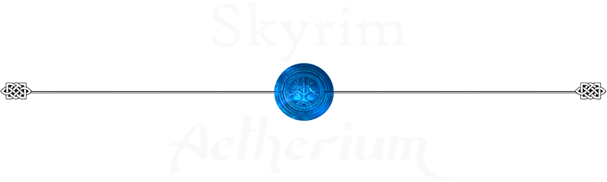

[Nexus Collection](https://www.nexusmods.com/games/skyrimspecialedition/collections/v1lgh0) | MO2 | Wabbajack | [Load Order](https://loadorderlibrary.com/lists/skyrim-aetherium-2) | [Screenshots](https://github.com/skyrim-aetherium/Aetherium/blob/main/images/screenshots/1.jpg) | [Youtube Trailer](https://www.youtube.com/watch?v=A1CbvUX1j8U) | [Changelog](https://github.com/skyrim-aetherium/Aetherium/blob/main/changelog.md) | [Test Coverage](https://github.com/skyrim-aetherium/Aetherium/blob/main/test_coverage.md) | 

**Disclaimer**: This page is a Work in Progress

Other links: 
- Gameplay Guide
  - Starting up
  - Detailed Quests routes (+links to original mods)

# Preview
**Aetherium** upgrades Skyrim to modern standards into an improved **Vanilla++** edition while remaining faithful to the original game. Each mod has been carefully selected to deliver a **cohesive**, **balanced**, **lore-friendly** and **stable** experience.

🔵 Aetherium is **plug-and-play** and **pre-configured**. Everything you need is bundled for an easy and smooth installation so you can start your journey right now.

🔵 Aetherium is also "**start and play**", which means that all added content blends seamlessly into the world without requiring to read extensive documentation to understand the game. Aside for a few gameplay changes and new key bindings, everything is the same as it always was, but better.

#### 📺 Gameplay Trailer : https://www.youtube.com/watch?v=A1CbvUX1j8U

- **Features**
- **Installation**
- **Getting Started**
- **Credits**

- **Plug-and-play** | Beginner friendly
- **Vanilla++** | Enhanced without becoming a different game - built around **Simonrim** with cherry-picked content from **Enaisiaion** and **colinswrath**
- **Lore-Friendly** | Every added content blends seamlessly into the world
- **Prettier than ever** | Improved textures, meshes, shaders and animations around **Community Shaders**, **NAT.CS III** and **Lux**
- **Immersive** | A slower pace, more meaningful progression without becoming tedious
- **Expanded Quests** | Most quests have new possibilities and offer choices that matter
- **Living world** | The world is alive and evolves around your actions (even when you're not there)
- **Balanced** | A challenging but fair and satisfying experience (ultimately: fun)
- **Combat** redone | Realistic and tense combats: adapt to every situation with the combat stances, timed blocks and quickstep dodge
- **Stealth** rebalanced | Challenging and fair: light and noise become more prevalent 
- **Magic & Spells** rebalanced and expanded | Every school of magic is now perfectly valid thanks to Mysticism and Lost Grimoire
- **New** armors, weapons, outfits, mage robes, staves, backpacks, spells and animated spears - All lore friendly
- **Extended Crafting** | Scrolls and staves crafting, artisans services and many more recipes
- **User Interface** redone with a classic RPG look - **Dear Diary paper menus**
- **Improved HUD** | Practical, lightweight and immersive 
- **Reputation System** | Your actions have consequences and people will react accordingly
- **Dragonborn skill tree** | Learn with the Greybeards to unlock the meditate power and spend your dragon souls to improve your shouting abilities
- **Bestiary** | Discover, document and learn about the creatures you encounter
- **Soft survival** (optional) | An engaging and immersive journey that never becomes a chore (fully customizable)
- **Roleplaying** | Player & NPCs dynamic animations & interactions, player origin story, play as a bard or a pugilist, rebuild the Vigilants of Stendarr, resist Daedric temptations, and much more...
- **Highly customisable** through the Mod Configuration Menu (MCM)

### 🔵 Extended Presentation
If you want to know more about Skyrim Aetherium's features, check this page : [Detailed Features](https://github.com/skyrim-aetherium/Aetherium/blob/main/features.md)

### 🔵 Screenshots
Check this page to enjoy some in-game [Screenshots](https://github.com/skyrim-aetherium/Aetherium/blob/main/images/screenshots)

### 🔵 Requirements
- **130GB** of available disk space
- **Skyrim Steam** latest version **1.7.104** in **English**
- Install [Visual C++ Redistributables 2022](https://learn.microsoft.com/en-us/cpp/windows/latest-supported-vc-redist?view=msvc-170)

#### ⚠️ Anniversary Edition disclaimer
The collection was built and tested **exclusively** on **Skyrim Special Edition**. Optional mods are included to provide compatibility with Creation Club content introduced by the Anniversary Edition, but these have not been tested.
> The worst you can expect when using Skyrim AE with CC content enabled is **minor inconsistencies** or visual glitches affecting Creation Club content **only**.

#### ⚠️ Version disclaimer
Skyrim Aetherium is build for version **1.6.1170** and works out of the box with the latest steam version (**1.7.104**) thanks to **Skyrim Runtime Swapper**.

Version **1.6.1170** should work if you disable **Skyrim Runtime Swapper** (untested)

The collection won't work for any older version.

#### ℹ️ Starting from a fresh, clean Skyrim installation is highly suggested to avoid conflict issues (or use Vortex profiles)

#### Vortex installation guide

  
Show

  Follow the dedicated "Installation" chapter at Nexus : https://www.nexusmods.com/games/skyrimspecialedition/collections/v1lgh0

#### Mod Organizer2 installation guide

  
Show

  ToDo

#### Wabbajack installation guide

  
Show

  ToDo

### 🔵 Recommended Hardware
Skyrim Aetherium was built for optimal balance around the following hardware setup.

#### Optimal Hardware
- Resolution : 1440p
- GPU : RTX 3080 / RX 6800 XT or equivalent (8+ GB VRAM)
- CPU : Ryzen 7 3700X / Intel i7-10700 or equivalent
- RAM : 16GB

#### Minimum Hardware
- Resolution : 1080p
- GPU : RTX 2060 / GTX 1080 / RX 6600 or equivalent (6–8 GB VRAM)
- CPU : Ryzen 5 3600 / Intel i5-10400 or equivalent
- RAM : 16 GB

### 🥔 Tips for low-end Hardware
- If you have a weak computer, I strongly advise to use [Texture Downscaler](https://www.nexusmods.com/skyrimspecialedition/mods/187049), it does miracles. I provided a default config for it here : [Aetherium SOAP](https://www.nexusmods.com/skyrimspecialedition/mods/186196?tab=files)
- Replace the default **TexGen** and **DynDOLOD**  from the collection with the performance version here : [Aetherium SOAP](https://www.nexusmods.com/skyrimspecialedition/mods/186196?tab=files) (parts 5 and 6)
- **Community Shaders** config menu (F10) has many settings regarding quality/performance. Disabling Screen Space GI will slightly improve performance.

# Getting Started

ToDo...

A huge thanks to these incredible authors whose work helped shape Aetherium.

- SimonMagus and all the Simonrim team
- EnaiSiaion
- JaySerpa
- Flowrifto
- powerofthree
- wSkeever
- jkrojmal
- Pfuscher
- Seb263
- The Community Shaders team & contributors
- GGUNIT
- ElSopa
- Verolevi
- Sigerious
- MihailMods

A very special thanks to **Ershin** for pushing Skyrim to it's next modding era and making me return to the game with his wonderful **Precision** and of course **Open Animation Replacer**.
Finally, thank you to every mod authors for their work and dedication.

Celtic divider asset by Shahina Parvin
Wizard Of The Moon font by RolandHuse
Nexusmods & Bethesda Softworks

If you like this collection, please endorse the original mods. Their authors deserve far more recognition than I do.

_Made with love and dedication_ - Silen
