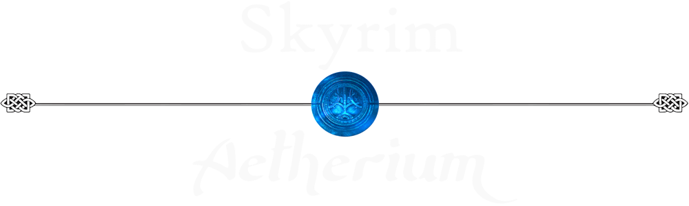

    <a href="https://www.nexusmods.com/games/skyrimspecialedition/collections/v1lgh0">Nexus Collection</a> |
    <a href="https://github.com/skyrim-aetherium/Aetherium">Wabbajack</a> |
    <a href="https://loadorderlibrary.com/lists/skyrim-aetherium-final">Load Order</a> |
    <a href="https://github.com/skyrim-aetherium/Aetherium/blob/main/gallery.md">Screenshots</a> |
    <a href="https://www.youtube.com/watch?v=A1CbvUX1j8U">Youtube Trailer</a> |
    <a href="faq.md">F.A.Q</a> |
    <a href="https://github.com/skyrim-aetherium/Aetherium/blob/main/test_coverage.md">Test Coverage</a> |
    <a href="https://github.com/skyrim-aetherium/Aetherium/blob/main/changelog.md">Changelog</a> |

  

**Aetherium** upgrades Skyrim to modern standards into an improved **Vanilla++** edition while remaining faithful to the original game. Each mod has been carefully selected to deliver a **cohesive**, **balanced**, **lore-friendly** and **stable** experience.

🔵 Aetherium is **plug-and-play** and **pre-configured**. Everything you need is bundled for an easy and smooth installation so you can start your journey right now.

🔵 Aetherium is also "**start and play**", which means that all added content blends seamlessly into the world without requiring to read extensive documentation to understand the game. Aside for a few gameplay changes and new key bindings, everything is the same as it always was, but better.

#### 📺 Gameplay Trailer : https://www.youtube.com/watch?v=A1CbvUX1j8U
#### 🖼️ Checkout some in-game screenshots : [Gallery](https://github.com/skyrim-aetherium/Aetherium/blob/main/gallery.md)

- [Features](#features)
- [Installation](#installation)
- [Getting Started](#getting-started)
- [Credits](#credits)

- **Plug-and-play** | Beginner friendly
- **Vanilla++** | Enhanced without becoming a different game - built around **Simonrim** with cherry-picked content from **Enaisiaion** and **colinswrath**
- **Lore-Friendly** | Every added content blends seamlessly into the world
- **Prettier than ever** | Improved textures, meshes, shaders and animations around **Community Shaders**, **NAT.CS III** and **Lux**
- **Immersive** | A slower pace, more meaningful progression without becoming tedious
- **Expanded Quests** | Most quests have new possibilities and offer choices that matter
- **Living world** | The world is alive and evolves around your actions (even when you're not there)
- **Balanced** | A challenging but fair and satisfying experience (ultimately: fun)
- **Combat** redone | Realistic and tense combats: adapt to every situation with the combat stances, timed blocks and quickstep dodge
- **Stealth** rebalanced | Challenging and fair: light and noise become more prevalent 
- **Magic & Spells** rebalanced and expanded | Every school of magic is now perfectly valid thanks to Mysticism and Lost Grimoire
- **New** armors, weapons, outfits, mage robes, staves, backpacks, spells and animated spears - All lore friendly
- **Extended Crafting** | Scrolls and staves crafting, artisans services and many more recipes
- **User Interface** redone with a classic RPG look - **Dear Diary paper menus**
- **Improved HUD** | Practical, lightweight and immersive 
- **Reputation System** | Your actions have consequences and people will react accordingly
- **Dragonborn skill tree** | Learn with the Greybeards to unlock the meditate power and spend your dragon souls to improve your shouting abilities
- **Bestiary** | Discover, document and learn about the creatures you encounter
- **Soft survival** (optional) | An engaging and immersive journey that never becomes a chore (fully customizable)
- **Roleplaying** | Player & NPCs dynamic animations & interactions, player origin story, play as a bard or a pugilist, rebuild the Vigilants of Stendarr, resist Daedric temptations, and much more...
- **Highly customisable** through the Mod Configuration Menu (MCM)

### 🔵 Extended Presentation
If you want to know more about Skyrim Aetherium's features, check this page : [Detailed Features](https://github.com/skyrim-aetherium/Aetherium/blob/main/features.md)

### 🔵 Screenshots
Check this page to view some in-game [Screenshots](https://github.com/skyrim-aetherium/Aetherium/blob/main/gallery.md)

### 🔵 Requirements
- **130GB** of available disk space
  - **230GB** of total disk space for the **Wabbajack** version (16GB for stock game + 130GB for complete Aetherium modlist + 77GB for downloads folder)
  - Wabbajack `\downloads` folder can be deleted after installation to save 77GB
- **Skyrim Steam** latest version **1.7.104** in **English**
- Install [Visual C++ Redistributables 2022](https://learn.microsoft.com/en-us/cpp/windows/latest-supported-vc-redist?view=msvc-170)

#### ⚠️ Anniversary Edition disclaimer
The collection was built and tested **exclusively** on **Skyrim Special Edition**. Optional mods are included to provide compatibility with Creation Club content introduced by the Anniversary Edition, but these have not been tested.
> ℹ️ The worst you can expect when using Skyrim AE with CC content enabled is **minor inconsistencies** or visual glitches affecting Creation Club content **only**.

#### ⚠️ Version disclaimer
Skyrim Aetherium is build for version **1.6.1170** and works out of the box with the latest steam version (**1.7.104**) thanks to **Skyrim Runtime Swapper**.

Version **1.6.1170** should work if you disable **Skyrim Runtime Swapper** (untested)

The collection won't work for any older version.

#### ℹ️ Starting from a fresh, clean Skyrim installation is highly suggested to avoid conflict issues (or use Vortex profiles)
## 🔵 Vortex / MO2 installation guide
Follow the dedicated "Installation" chapter at Nexus : https://www.nexusmods.com/games/skyrimspecialedition/collections/v1lgh0

## 🔵 Wabbajack installation guide
1. Install Skyrim's latest version through **Steam**, in **English**
2. Launch it once
3. Download [Wabbajack](https://www.wabbajack.org/) and place it in a dedicated folder (like: `C:\Wabbajack`)
4. Download [Skyrim Aetherium.wabbajack](https://build.wabbajack.org/authored_files/download/Skyrim.Aetherium.wabbajack_dac5f358-0a93-401f-8ac8-dac2a325ad42)
5. Run `skyrim.aetherium.wabbajack`
6. Follow the download and installation process
    - If asked "_files that are not part of the modlist will be deleted_", click `Continue`
    - If you own the **Anniversary Edition**, run `ModOrganizer.exe` and enable **all** the optional AE compatibility mods at the bottom of the left pane (once Wabbajack is done installing Aetherium)
7. Delete everything within `\downloads` to free some disk space (**77GB**)
8. Run `create_aetherium_shortcut.bat` if you want a dedicated shortcut (Located in the root folder of **Skyrim Aetherium**)
9. Run **Skyrim Aetherium**
10. Create a **new** character
11. Read the **Book of Origins** on the table (optional)
12. Interact with the statue
13. Wait for the message "_Aetherium auto-config has finished playing_"
14. Manually save and **RELOAD** the game
15. Go to bed

## 🔵 Recommended Hardware
Skyrim Aetherium was built for optimal balance around the following hardware setup.

#### Optimal Hardware
- Resolution : 1440p
- GPU : RTX 3080 / RX 6800 XT or equivalent (8+ GB VRAM)
- CPU : Ryzen 7 3700X / Intel i7-10700 or equivalent
- RAM : 16GB

#### Minimum Hardware
- Resolution : 1080p
- GPU : RTX 2060 / GTX 1080 / RX 6600 or equivalent (6–8 GB VRAM)
- CPU : Ryzen 5 3600 / Intel i5-10400 or equivalent
- RAM : 16 GB

### 🥔 Tips for low-end Hardware
- If you have a weak computer, I strongly advise to use [Texture Downscaler](https://www.nexusmods.com/skyrimspecialedition/mods/187049), it does miracles. I provided a default config for it here : [Aetherium SOAP](https://www.nexusmods.com/skyrimspecialedition/mods/186196?tab=files)
- Replace the default **TexGen** and **DynDOLOD**  from the collection with the performance version here : [Aetherium SOAP](https://www.nexusmods.com/skyrimspecialedition/mods/186196?tab=files) (parts 5 and 6)
- **Community Shaders** config menu (F10) has many settings regarding quality/performance. Disabling Screen Space GI will slightly improve performance.

The game is a bit different from vanilla, here is the main things you should know before starting a new game:
- 🔵 [**Alternate start**](https://www.nexusmods.com/skyrimspecialedition/mods/272) provides new ways to start your journey while preserving the original beginning. Visit **Helgen** to start the main quest if you started elsewhere
- 🔵 [**Why I Came to Skyrim**](https://www.nexusmods.com/skyrimspecialedition/mods/167166) provides optional starting quests to add more flavor to your character. Read the **Book of Origin** in the starting cell to choose your backstory.
- 🔵 [**Experience**](https://www.nexusmods.com/skyrimspecialedition/mods/17751) makes skill leveling and character leveling independent. You will earn character XP through exploration, quests and by killing things. It allows more build freedom and depth by removing the need to grind skills you have no interest in, allowing more authentic character builds
- 🔵 [**Blade & Blunt**](https://www.nexusmods.com/skyrimspecialedition/mods/34549) adds more more depth to combat by introducing meaningful stamina management, attacks of opportunity, timed blocks and injury system. (You can find more details on the mod's page)
- 🔵 [**Stances NG**](https://www.nexusmods.com/skyrimspecialedition/mods/117986) introduces 4 new combat stances to add more possibilities to melee combat
- 🔵 [**TK Dodge**](https://www.nexusmods.com/skyrimspecialedition/mods/56956) allow you and some NPCs to perform quickstep dodge
- 🔵 [**Wheeler**](https://www.nexusmods.com/skyrimspecialedition/mods/97345) adds a quick action wheel to access your favorite items in addition to the vanilla favorite menu
- 🔵 [**Apothecary**](https://www.nexusmods.com/skyrimspecialedition/mods/52130) changes healing, magic and stamina potions into effects over time (10sec)
- 🔵 [**SunHelm**](https://www.nexusmods.com/skyrimspecialedition/mods/39414) reworks survival with sleep, hunger and thirst management (cold disabled by default). You can ask bar tenders for food and fresh water. You will also be able to refill your bottles from any source of water (rivers, sea and also wells in town)
- 🔵 [**Campsite**](https://www.nexusmods.com/skyrimspecialedition/mods/22353) provides furniture you can place by simply dropping them outside of town. Build campfires by activating firewood(3) in your inventory
- 🔵 [**Stormcrown**](https://www.nexusmods.com/skyrimspecialedition/mods/90659) adds the **Meditate** power that you can learn from the Greybeards to strengthen your shouting abilities through the new **Dragonborn perk tree**
- 🔵 [**Hand to Hand**](https://www.nexusmods.com/skyrimspecialedition/mods/59790) adds a new **Pugilist skill tree** and also merges **Lockpicking** and **Pickpocket** into **Security**
- 🔵 [**Sacrilege**](https://www.nexusmods.com/skyrimspecialedition/mods/42408) changes vampirism with reverse progression : You will be stronger and have more power when recently fed. You will also grow stronger as you age as a vampire
- 🔵 [**Skyrim's Got Talent**](https://www.nexusmods.com/skyrimspecialedition/mods/50357) allows you to play instruments by activating them from your inventory. The more you play, the better you get. The **Speech** skill tree now has a few skills for **Bards**. Skilled bards can provide buffs to themselves and their allies
- 🔵 [**Skyrim Souls RE - Unpaused Menus**](https://www.nexusmods.com/skyrimspecialedition/mods/27859) makes inventory and lockpicking menus unpaused - the time is slowed when an enemy is nearby
- 🔵 [**Grab and Throw**](https://www.nexusmods.com/skyrimspecialedition/mods/120460) any item to distract ennemies or just for fun
- 🔵 [**Skyrim Reputation**](https://www.nexusmods.com/skyrimspecialedition/mods/22374) introduces a reputation mechanic to make everyone consider you as the hero or villain you are, without it interfering with your gameplay
- 🔵 [**C.O.I.N**](https://www.nexusmods.com/skyrimspecialedition/mods/51439) adds new currencies you can find in dungeons. You can exchange them to Septims from any merchant

ℹ️ Several new key bindings have been added to the game, reading **Key Bindings** below is **highly** suggested

### ☠️ Game Difficulty

The game will be slightly harder and slower than vanilla. The entire progression, economy and combat systems have been reworked to achieve a slower paced journey with a meaningful progression and a challenging, yet satisfying experience. Those are unrelated to the in-game difficulty settings.

Here are the changes you can expect from the pre-configured version of **Skyrim Aetherium**:

    
Detailed difficulty settings

    
- **Experience** is now earned through exploration, questing and combat - The leveling pacing isn't impacted much
- **Slower progression** for the early levels
- **Loot found** is reduced and food is sometimes spoiled
- **Unpaused menus** with time slowed in combat. Applies only to menus in which **you can see** around you and to lockpiking/pickpocket. Map and leveling menus aren't affected
- **Trading** - Merchants will be tougher negotiators
- **Combat modifications** introduces an injury system and meaningful stamina management
- **Dodge quickstep** - Adds defensive option and improves the survivability of light-armored characters
- **Potions** turn into healing over time (10s) and do not stack - Applies to healing, stamina and magicka
- Some NPCs can use potions
- Some NPCs can dodge your attacks
- **Suspicious guards** - Guards may check bags and investigate suspicious behavior (being a Khajiit or an Argonian is considered suspicious in Skyrim...)
- **NPC combat AI** improved
- **Soft survival** enabled by default - With the mod [SunHelm Survival and needs](https://www.nexusmods.com/skyrimspecialedition/mods/39414)
- **Quest pacing** - The main quest and main factions quests have more side quests and progression requirements so you don't become Archmage after 3 days at the college

Most of these settings can be easily tweaked from the **Mod Configuration Menu (MCM)** and even disabled.

> ℹ️ See the [F.A.Q](https://github.com/skyrim-aetherium/Aetherium/blob/main/faq.md) to customize the difficulty of your game

### Soft-core

The overall vision of **Skyrim Aetherium** is to bring more challenge and meaning to the world without changing the game into a grinding chore. The pre-configuration of **Skyrim Aetherium** leans toward a "**soft-core**" experience balanced around a slower progression than vanilla while preserving character growth.

However, balance and difficulty are subjective: this is why I made a guide in the **F.A.Q** to help you tweak the collection's difficulty to your taste. Take a look at the **Suggested Mods** chapter for even more ideas.

## 🔵 Key Bindings
Several mods of the collection adds new key binding. Here are below the default configuration and how to change them to your liking.

ℹ️ If you wish to change hotkeys within config files, use this inputs list : [**https://ck.uesp.net/wiki/Input\_Script#DXScanCodes**](https://ck.uesp.net/wiki/Input_Script#DXScanCodes)

⌨️ Keyboard

    
[**Stances NG**](https://www.nexusmods.com/skyrimspecialedition/mods/117986)

- Default stance `X`
- High stance `F1`
- Mid stance `F2`
- Low stance `F3`
- can be changed in `\Skyrim Special Edition\Data\SKSE\Plugins\StancesNG.toml`

[**Read the Room**](https://www.nexusmods.com/skyrimspecialedition/mods/77605)

- `H` to unequip/equip helmet - Helmet is automatically equipped when entering combat
- Can be changed in "Read the Room" **MCM**

[**TK Dodge RE**](https://www.nexusmods.com/skyrimspecialedition/mods/56956) (quickstep)

- `Middle_Mouse_Button`&#x20;
- Can be changed in `\Skyrim Special Edition\Data\SKSE\Plugins\TK Dodge RE.ini`

[**Wheeler**](https://www.nexusmods.com/skyrimspecialedition/mods/97345) (quick actions wheel)

- `Mouse_button_5`
- Press in game to use the wheel
- Press in menu to customize the wheel
- Wheeler can be customized using **dMenu** which you can open with the `home` key

[**HorsePower**](https://www.nexusmods.com/skyrimspecialedition/mods/169335)

- Long press `E` to dismount

[**Bestiary**](https://www.nexusmods.com/skyrimspecialedition/mods/123521?tab=description)

- `K` to open the bestiary
- You can find the bestiary in the main menu, in the **system** tab

[**Better Third Person Selection**](https://www.nexusmods.com/skyrimspecialedition/mods/64339)

- `Shift` **+** `Middle_Mouse_Scroll` to navigate loot (on the ground) in 3rd person

[**Better Grabbing**](https://www.nexusmods.com/skyrimspecialedition/mods/134769)

- `LMB` to rotate objects
- `RMB` to move objects on **X** and **Y** axis
- `Middle_Mouse_Button` to move objects on **Z** axis

[**Grab and Throw**](https://www.nexusmods.com/skyrimspecialedition/mods/120460)

- Grab any item with `E` and press `R` (sheath) to throw. The longer the press, the further you throw

🎮 Gamepad

To change inputs, check "keyboard" section above. Gamepad has not been tested at all, visite each mod's page for dedicated config.

> ⚠️ Using an extended hotkey manager is highly suggested for gamepad

[**Stances NG**](https://www.nexusmods.com/skyrimspecialedition/mods/117986)

- `None` by default
- Update `\Skyrim Special Edition\Data\SKSE\Plugins\StancesNG.toml` by using it's [**official documentation**](https://codeberg.org/Styyx/StancesSKSE/src/branch/main/Readme.md)

[**Read the Room**](https://www.nexusmods.com/skyrimspecialedition/mods/77605)

- `None` by default
- You can change MCM settings to auto unequipe in town
- Helmet is automatically equipped when entering combat

[**TK Dodge RE**](https://www.nexusmods.com/skyrimspecialedition/mods/56956) (quickstep)

- `None` by default
- Update `\Skyrim Special Edition\Data\SKSE\Plugins\TK Dodge RE.ini` and either set `EnableSprintKeyDodge` to `true` or define your own input under `DodgeHotkey`

[**Wheeler**](https://www.nexusmods.com/skyrimspecialedition/mods/97345) (quick actions wheel)

- `LT`
- Press in game to use the wheel
- Press in menu to customize the wheel
- Wheeler can be customized using **dMenu** which you can open with the `home` key

[**HorsePower**](https://www.nexusmods.com/skyrimspecialedition/mods/169335)

- Long press to dismount

[**Bestiary**](https://www.nexusmods.com/skyrimspecialedition/mods/123521?tab=description)

- You can find the bestiary in the main menu, in the **system** tab

[**Better Third Person Selection**](https://www.nexusmods.com/skyrimspecialedition/mods/64339)

- `None` by default
- Check this post to set it up : [**Nexus post**](https://www.nexusmods.com/skyrimspecialedition/mods/64339?tab=posts\&comment_id=113225413)

[**Better Grabbing**](https://www.nexusmods.com/skyrimspecialedition/mods/134769)

- `LT` + `Analog` to rotate objects
- `RT` + `Analog` or `D-pad` to move objects on **X** and **Y** axis
- `LB` + `Analog` to move objects on **Z** axis

[**Grab and Throw**](https://www.nexusmods.com/skyrimspecialedition/mods/120460)

- Grab any item with `A` and press `X` (sheath) to throw. The longer the press, the further you throw

## 🔵 Mods Configuration & Recommended Mods
Check here [Mods configuration & Recommended Mods](https://github.com/skyrim-aetherium/Aetherium/blob/main/mods_configuration.md) to learn how to customize further the mods of Skyrim Aetherium. The page also contains a few suggested mods to safely expand the list.

Please, read the [F.A.Q](https://github.com/skyrim-aetherium/Aetherium/blob/main/faq.md) before posting a bug or a question. Otherwise, you can reach me out in the [Nexus collection's comments](https://www.nexusmods.com/games/skyrimspecialedition/collections/v1lgh0/comments)

Huge thanks you to [Spooknik](https://github.com/spooknik) for his wonderful tool [c2mo2](https://github.com/spooknik/collections2mo2) which helped me port the Nexus collection to MO2/Wabbajack and saved me a huge amount of time.

A huge thanks to these incredible authors whose work helped shape Aetherium.

- [SimonMagus](https://www.nexusmods.com/profile/SimonMagus) and all the Simonrim team
- [EnaiSiaion](https://www.nexusmods.com/profile/EnaiSiaion)
- [JaySerpa](https://https://www.nexusmods.com/profile/jayserpa)
- [Flowrifto](https://www.nexusmods.com/profile/Flowrifto)
- [powerofthree](https://www.nexusmods.com/profile/powerofthree)
- [wSkeever](https://www.nexusmods.com/profile/wSkeever/mods?gameId=1704\&sortBy=downloads)
- [jkrojmal](https://www.nexusmods.com/profile/jkrojmal/mods?gameId=1704\&sortBy=downloads\&page=3)
- [Pfuscher](https://www.nexusmods.com/profile/Pfuscher/mods?gameId=1704\&sortBy=downloads)
- [Seb263](https://www.nexusmods.com/profile/Seb263/mods?gameId=1704\&sortBy=endorsements)
- The [Community Shaders](https://www.nexusmods.com/skyrimspecialedition/mods/86492) team & contributors
- [GGUNIT](https://www.nexusmods.com/profile/GGUNIT)
- [ElSopa](https://www.nexusmods.com/profile/ElSopa/mods?gameId=1704)
- [Verolevi](https://www.nexusmods.com/profile/Verolevi/mods?gameId=1704\&sortBy=downloads\&page=2)
- [Sigerious](https://www.nexusmods.com/profile/Sigerious/mods?gameId=1704)
- [MihailMods](https://www.nexusmods.com/profile/MihailMods/mods?gameId=1704)

A very special thanks to [Ershin](https://www.nexusmods.com/profile/Ershin) for pushing Skyrim to it's next modding era and making me return to the game with his wonderful [**Precision**](https://www.nexusmods.com/skyrimspecialedition/mods/72347) and of course [Open Animation Replacer](https://www.nexusmods.com/skyrimspecialedition/mods/92109).

- Celtic divider asset by [**Shahina Parvin**](https://www.vecteezy.com/members/bornostock)
- [Wizard Of The Moon](https://www.dafont.com/wizard-of-the-moon.font) font by [RolandHuse](https://www.creativefabrica.com/es/designer/roland-huse-design/ref/2092)
- [Nexusmods](https://www.nexusmods.com/) & [Bethesda Softworks](https://bethesda.net/)

If you like this collection, please endorse the original mods. Their authors deserve far more recognition than I do.

_Made with love and dedication_ - Silen
